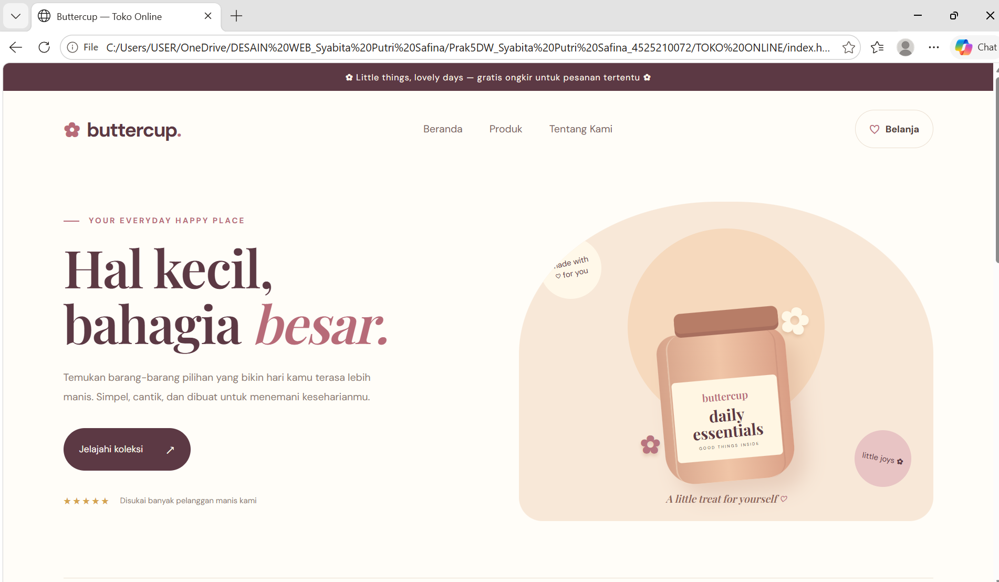
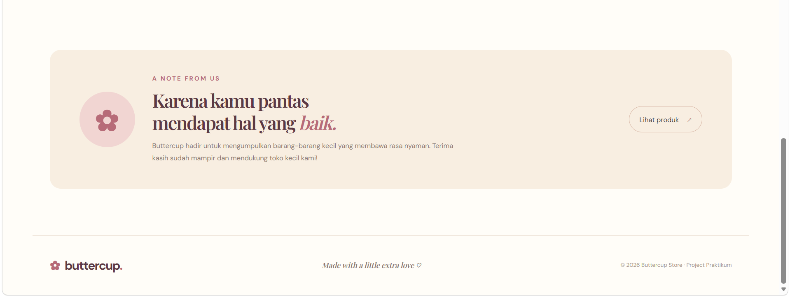
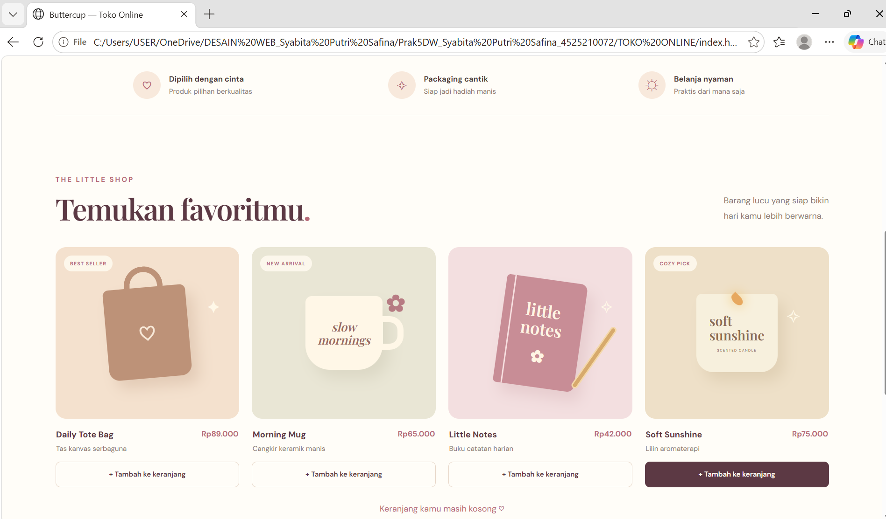

# Buttercup — Toko Online

Project praktikum front-end berupa website toko online bernama **Buttercup** dengan nuansa warna cream, peach, cokelat, dan soft pink. Desain dibuat minimalis, lucu, dan responsif agar nyaman digunakan melalui laptop maupun HP.

## 1. Struktur Folder

```text
toko_online_cream/
├── index.html
├── style.css
├── README.md
└── screenshot-hasil-web.png
```

**Keterangan file:**
- `index.html` — berisi struktur halaman website, navigasi, informasi toko, dan kartu produk.
- `style.css` — mengatur tampilan website, palet warna, layout, tombol, dan desain responsif.
- `README.md` — dokumentasi project yang menjelaskan fitur, warna, dan cara menjalankan website.
- `screenshot-hasil-web.png` — gambar hasil tampilan website untuk dokumentasi praktikum.

## 2. Screenshot Hasil Website

### Beranda


### Notes


### Temukan Favorit

## 3. Palet Warna

Website Buttercup menggunakan kombinasi warna pastel yang lembut agar terlihat hangat dan menarik.

| Nama Warna | Kode HEX | Penggunaan |
|---|---|---|
| Cream | `#FFFAF0` | Latar utama website |
| Paper White | `#FFFDF8` | Latar halaman |
| Butter Yellow | `#F7E9BB` | Aksen dekorasi |
| Peach | `#F3CBB6` | Ilustrasi dan elemen dekoratif |
| Soft Pink | `#F2D5D7` | Aksen produk |
| Dusty Rose | `#B76B78` | Tombol dan teks aksen |
| Plum Brown | `#5C3944` | Judul dan tombol utama |
| Warm Brown | `#4F3D39` | Teks utama |

## 4. Fitur Website

- Navigasi Beranda, Produk, dan Tentang Kami.
- Hero section dengan tombol untuk melihat koleksi produk.
- Empat kartu produk yang menampilkan nama, deskripsi, dan harga.
- Tombol tambah ke keranjang dengan pesan interaktif.
- Bagian keunggulan toko.
- Bagian Tentang Kami.
- Tampilan responsif untuk desktop, tablet, dan mobile.

## 5. Teknologi yang Digunakan

- HTML5 untuk struktur halaman.
- CSS3 untuk desain dan tata letak.
- JavaScript untuk interaksi tombol keranjang.
- Google Fonts: DM Sans dan Playfair Display.

## 6. Cara Menjalankan Website

1. Buka folder `toko_online_cream` melalui Visual Studio Code.
2. Pastikan file `index.html` dan `style.css` berada dalam folder yang sama.
3. Buka file `index.html`.
4. Klik kanan, kemudian pilih **Open with Live Server** jika ekstensi Live Server sudah terpasang.
5. Website akan terbuka di browser dan siap digunakan.

## 7. Kesimpulan

Website Buttercup merupakan project praktikum pembuatan toko online sederhana menggunakan HTML, CSS, dan JavaScript. Website ini memiliki tampilan yang menarik dengan kombinasi warna pastel, kartu produk, navigasi, dan interaksi keranjang. Desain responsif diterapkan agar tampilan dapat menyesuaikan ukuran layar perangkat. Website ini masih berupa simulasi front-end dan belum terhubung dengan database maupun sistem pembayaran.

## 8. Pembagian Peran Kelompok

- Perancangan wireframe desktop dan mobile: Nama anggota
- Pembuatan struktur HTML: Nama anggota
- Styling CSS dan desain responsif: Nama anggota
- Pengujian website, screenshot, dan dokumentasi: Nama anggota
